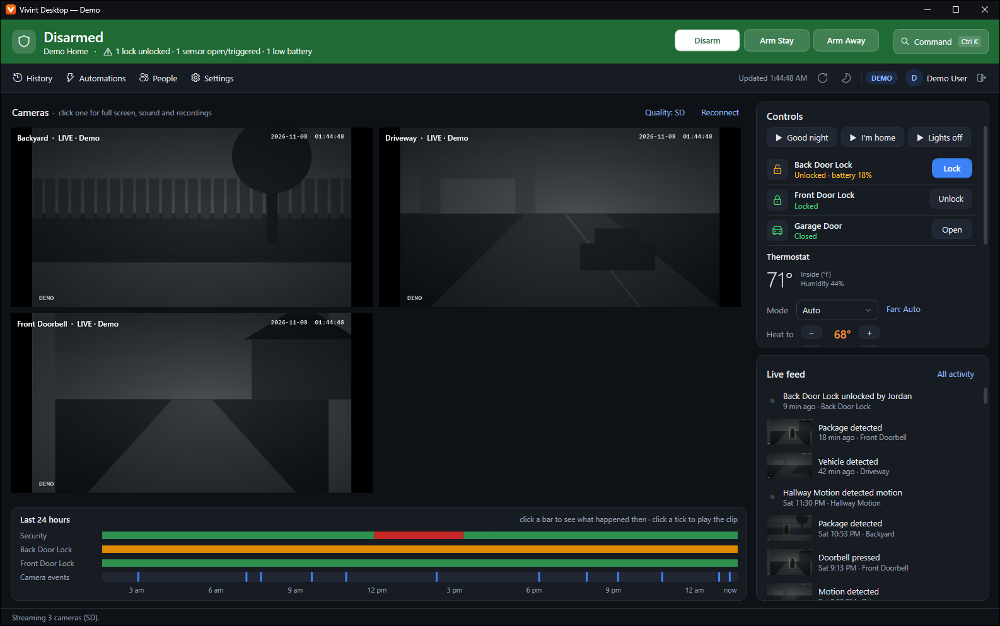
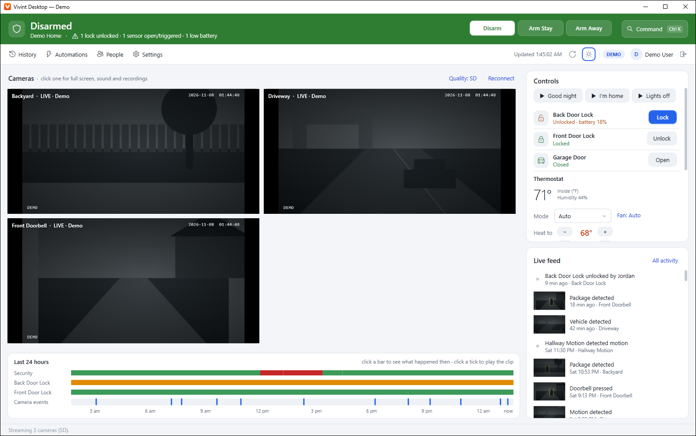
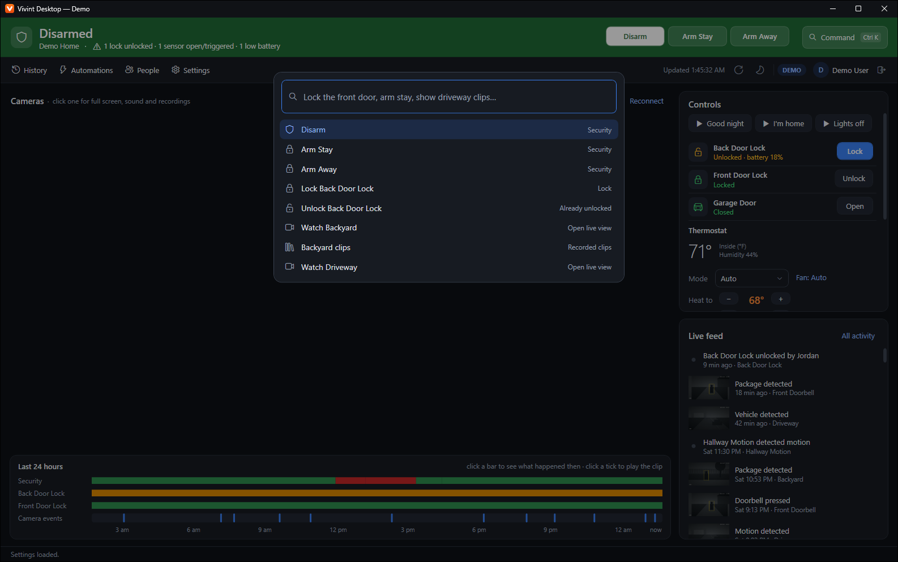
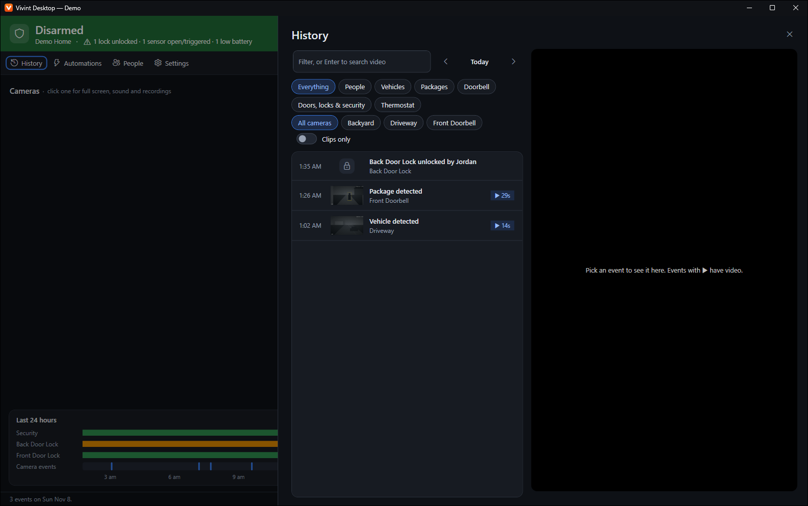
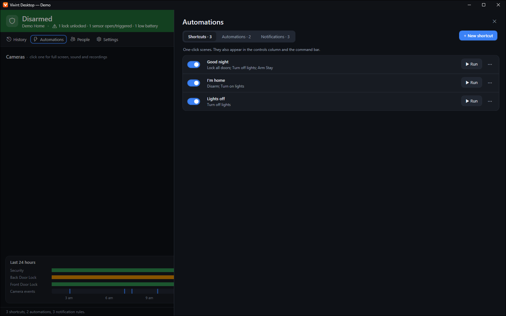
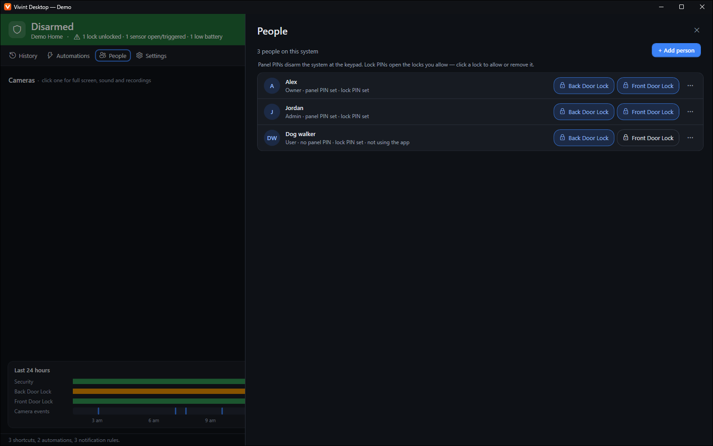
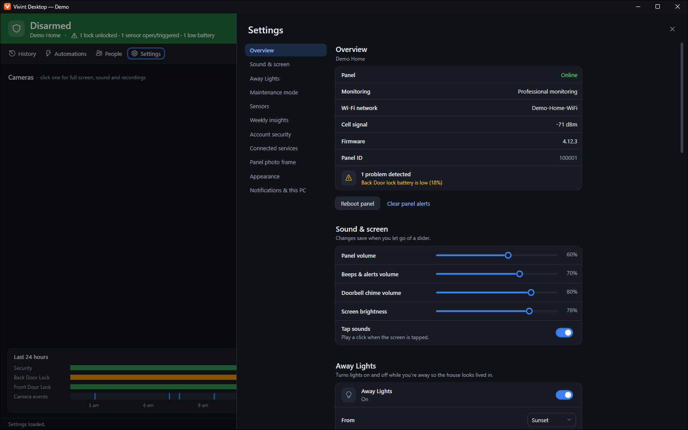

# Vivint Desktop

A native Windows app for keeping an eye on your Vivint home from your PC. It puts your cameras, locks, thermostat and security panel on one screen, so you don't have to pick up your phone.

> **Not affiliated with Vivint.** This is an independent, unofficial project. It isn't made, endorsed or supported by Vivint or any of its parent companies, and "Vivint" is used only to describe what the app connects to. Please don't contact Vivint for help with it. You need your own Vivint account, and you use this at your own risk.



## Features

**Home screen**
- Status band that changes color with the armed state, with Disarm, Arm Stay and Arm Away buttons
- Live view of all your cameras at once, SD or HD. Click one for full screen, sound and recordings
- Timeline of the last 24 hours: security state, locks and camera events
- Locks, garage doors, lights, switches and thermostat controls
- Live feed of what's happening at home, updated in real time

**Command bar**

Press `Ctrl+K` and start typing to lock a door, arm the system, or jump to a camera without touching the mouse.

**History**

Browse any day's events, filter by type or camera, and play clips right next to the list. Use the arrow keys to move through events and `Del` to remove a clip.

**Automations**

Run, create and edit shortcuts, turn automations on and off, and manage notification rules.

**People**

See who's on the system, manage panel and lock PINs, choose which locks each person can open, and send invites.

**Settings**

Panel info and health, sound and screen brightness, Away Lights, maintenance mode, sensors, weekly insights, two-factor authentication, connected services and the panel photo frame.

**On the desktop**

Tray icon, Windows notifications, and light, dark or system themes.

## Screenshots

| | |
|---|---|
|  |  |
| Light theme | Command bar |
|  |  |
| History | Automations |
|  |  |
| People | Settings |

All screenshots were taken in demo mode, so the home, people and events shown are sample data.

## Getting started

You'll need 64-bit Windows (it's been tested on Windows 11) and the [Microsoft Edge WebView2 Runtime](https://developer.microsoft.com/microsoft-edge/webview2/), which Windows 11 already includes. .NET doesn't need to be installed.

1. Download the latest zip from the [Releases](../../releases) page and extract it anywhere you like. Keep `VivintDesktop.exe` and `libmpv-2.dll` together.
2. Run `VivintDesktop.exe`.
3. Sign in on Vivint's login page, which opens inside the app.

The first launch takes a little longer while Windows unpacks the app.

### Try it without an account

Click **Try demo mode** on the sign-in screen, or start the app from a terminal:

```bash
VivintDesktop.exe --demo
```

Demo mode runs against a made-up home. Nothing is sent to Vivint, and the cameras show drawn pictures instead of video.

## Privacy and sign-in

You sign in on Vivint's own page, in an embedded browser, using OAuth with PKCE. That includes any verification code they ask for. The app never sees your password.

If you stay signed in, the refresh token is stored in `%APPDATA%\VivintDesktop\session.bin`, encrypted with Windows DPAPI so only your Windows user can read it. **Sign out** removes it along with the browser cookies.

The app talks to Vivint's services, your own panel, and the third-party services Vivint's platform relies on: PubNub for real-time updates and Google Firebase for video search. It doesn't send analytics.

## Building from source

You'll need the [.NET 10 SDK](https://dotnet.microsoft.com/download/dotnet/10.0).

Run it directly:

```bash
dotnet run --project src/VivintDesktop
```

Or publish a self-contained copy to `dist/`:

```bash
powershell -ExecutionPolicy Bypass -File build.ps1
```

## Project layout

```
screenshots/            Images used in this readme
src/VivintDesktop/
  Api/                  Vivint client, sign-in, data models, demo backend
  Assets/               App icon
  Video/                mpv interop and the camera video surface
  Views/                Sign-in, camera window, routine editor, dialogs
  native/               libmpv-2.dll
tools/
  gen_csharp.py         Generates the Api/*.g.cs endpoint bindings
  catalog.json          Endpoint definitions used by the generator
  baseurls.json         Host and auth settings for each API group
  libmpv/               Scripts used to build the bundled libmpv
build.ps1               Publishes the app to dist/
VivintDesktop.sln
```

To regenerate the endpoint bindings (needs Python 3):

```bash
python tools/gen_csharp.py tools/catalog.json tools/baseurls.json src/VivintDesktop/Api
```

## Built with

- .NET 10 and WPF
- [Microsoft WebView2](https://developer.microsoft.com/microsoft-edge/webview2/) for sign-in
- [mpv](https://mpv.io/) (libmpv 0.42.0) with [FFmpeg](https://ffmpeg.org/) for live video and clips. The bundled library is a stripped-down build, made with the scripts in `tools/libmpv`

## Known limitations

- Windows only.
- Vivint's API isn't public, so it can change at any time and break parts of the app.
- Video search in History sends the query but hasn't returned results on the system it was tested with.
- Camera settings can't be changed from the app.
- Some actions haven't been tested against a real system: changing PINs, adding or removing people, invites, deleting clips, maintenance mode, 2FA setup, the photo frame, garage doors, switches and dimmers. Be careful with these on a system you depend on.

This app is a convenience and isn't a replacement for your panel or professional monitoring. Don't rely on it for safety-critical alerts.
